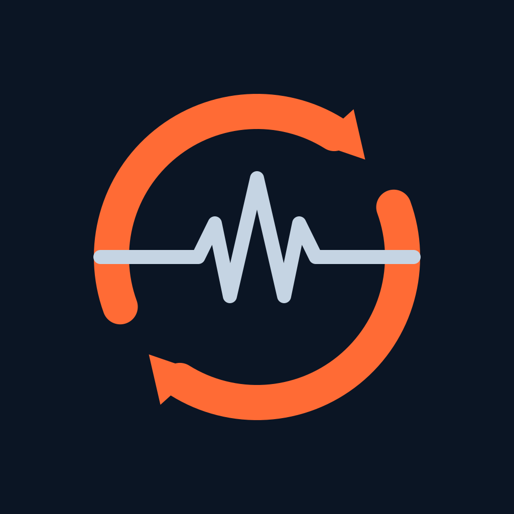

#  Better Mi Fitness Sync (iOS)

把**小米运动健康（Mi Fitness）**的完整数据同步到 **Apple Health**：步数、心率、**完整睡眠分期（深睡/浅睡/REM/清醒）**、血氧、体重、运动记录（含 GPS 轨迹）等。

这是 [ilyasaftr/better-mi-fitness-sync](https://github.com/ilyasaftr/better-mi-fitness-sync) 的 iOS 定制版。原版要求**付费 Apple Developer 账号**才能写入健康数据，本版通过构建时注入 HealthKit entitlement，**免费 Apple ID + Impactor 即可安装使用**。

## 为什么需要它

小米运动健康官方 App 写入 Apple Health 的睡眠只有一条「卧床」区间，深睡/浅睡/REM 分期全部丢失（广为报告的缺陷）。本 App 从小米云读取完整睡眠分期并**逐段写入** Apple Health，还会合并/覆盖官方写入的残缺数据。

## 安装（免费 Apple ID 即可）

1. 到 **Actions → build ipa** 下载最新构建产出的 IPA；
2. 电脑上安装 [Impactor](https://github.com/claration/impactor)（支持 Windows/macOS/Linux）；
3. iPhone 用 USB 连接电脑，Impactor 登录你的**个人 Apple ID（免费即可）**；
4. 拖入 IPA，勾选 **Only Register Main Bundle**，点 Install；
5. iPhone 上「设置 → 通用 → VPN 与设备管理」信任证书；
6. 打开 App → 登录小米账号 → 授权 Apple Health → 同步。

**不需要**付费开发者账号、不需要 Mac、不需要容器。

> 提示：免费 Apple ID 签名的 App 有效期 7 天，到期后用 Impactor 重签一次即可。

## 使用前提

- 手环数据需已通过**小米运动健康 App** 同步到小米云（本 App 不连接手环，只读云端数据）；
- 登录的小米账号需与小米运动健康中使用的账号一致；
- 建议在 Apple Health 中关闭小米运动健康的「写入」权限，避免两份数据冲突（保留其同步上云功能）。

## 构建

仓库自带 GitHub Actions 工作流 **`build ipa`**（`.github/workflows/build-ipa.yml`）：在 macOS runner 上编译 iOS IPA，并在打包前用 ad-hoc codesign 把 HealthKit entitlement 注入主二进制——这正是免费 Apple ID 能获得健康权限的关键。

手动触发：Actions 页面选择 `build ipa` → Run workflow。

本地构建：`bash ./gradlew :composeApp:linkReleaseFrameworkIosArm64` 后用 XcodeGen 生成工程并 `xcodebuild` 编译打包。

## 工作原理

- 使用 Kotlin Multiplatform（KMP）+ Compose，业务逻辑跨平台共享，iOS 外壳为 SwiftUI；
- 逆向小米运动健康云协议：小米账号登录获取 `serviceToken` 等凭据，RC4 变体签名算法请求 `*.hlth.io.mi.com` 加密接口；
- 按时间增量拉取步数/心率/血氧/睡眠/体重/运动等数据，GPS 轨迹经 FDS 预签名 URL 下载后 AES 解密解析；
- 通过 HealthKit 写入，以稳定的 syncIdentifier + syncVersion 做 upsert 去重，体重支持双向同步。

## 隐私

- 小米账号登录凭据仅保存在本机；
- 数据流向：小米云 → 你的 iPhone → Apple Health，不经过任何第三方服务器；
- 无数据采集、无遥测。
